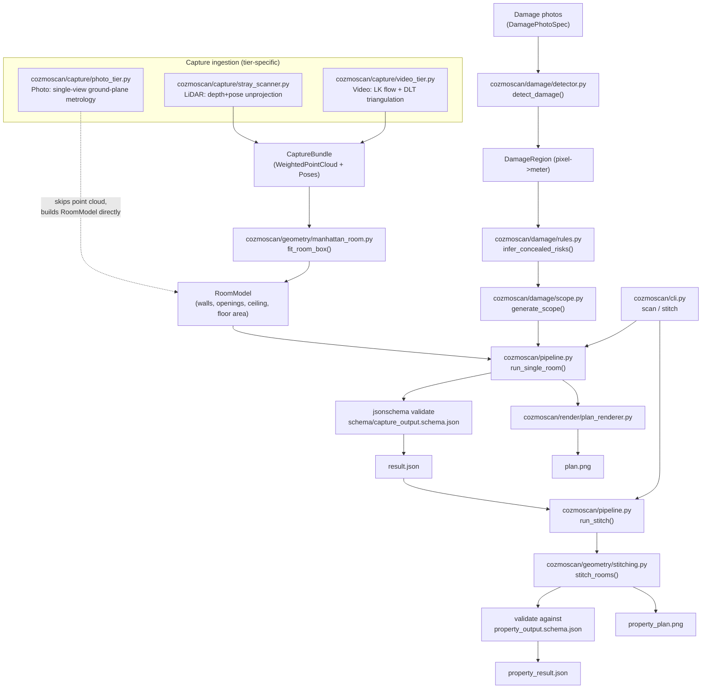

# 01 - Architecture

## Design principle: converge early, diverge late

All 3 capture tiers (Photo / Video / LiDAR) are fundamentally different sensing problems - a
LiDAR scan gives dense posed depth, a handheld video gives posed RGB only, a handful of stills
give neither pose nor depth. Rather than build 3 separate reconstruction pipelines, every tier
converges onto the **same two intermediate representations** before any shared geometry code
runs:

- `WeightedPointCloud` - an (N,3) point set with a per-point confidence weight.
- An optional list of `Pose` (camera trajectory), when available.

Everything downstream of that point (Manhattan room-box fitting, opening detection, stitching,
rendering) is tier-agnostic. This makes "same output contract from every tier" an architectural
property rather than something each tier has to re-implement - see
[cozmoscan/types.py](../cozmoscan/types.py) module docstring.

## Pipeline stages

## Package layout

| Module | Responsibility |
|---|---|
| `cozmoscan/types.py` | Core dataclasses shared everywhere: `Pose`, `Intrinsics`, `WeightedPointCloud`, `CaptureBundle`, `Measurement`, `Opening`, `Wall`, `RoomModel`, `DamageRegion`, `ScopeLineItem`. All have `as_dict()`/`from_dict()` for JSON round-tripping. |
| `cozmoscan/capture/stray_scanner.py` | Real parser for Stray Scanner app exports; depth+pose+intrinsics unprojection to world-frame points, confidence-weighted, voxel-downsampled. LiDAR tier. |
| `cozmoscan/capture/video_tier.py` | Motion-based keyframing, Lucas-Kanade optical-flow tracking, linear DLT triangulation from RGB+poses only (depth/confidence dropped - simulates a non-LiDAR phone's ARKit VIO). Video tier. |
| `cozmoscan/capture/photo_tier.py` | Single-view ground-plane metrology (Canny+Hough floor/ceiling boundary, assumed eye-height camera, similar-triangles depth) on stills sampled from the same video. Photo tier. |
| `cozmoscan/capture/frame_utils.py` | Shared video-frame extraction helper used by both video and photo tiers. |
| `cozmoscan/geometry/histogram.py` | Generic 1D peak-finder (bin + merge + min-support) - reused for floor/ceiling detection AND wall-position detection. |
| `cozmoscan/geometry/manhattan_room.py` | `fit_room_box()`: the core reconstruction algorithm (RANSAC Manhattan-angle fit, histogram wall positions, per-wall opening detection). Tier-agnostic. |
| `cozmoscan/geometry/triangulation.py` | Reusable multi-view linear triangulation (DLT), reprojection error, projection matrices - used by the video tier. |
| `cozmoscan/geometry/stitching.py` | `Connector`, `RoomPlacement`, `stitch_rooms()` - combines N independently-reconstructed rooms into one globally-consistent property, with an on/off drift-correction ablation. |
| `cozmoscan/damage/detector.py` | Classical CV damage detectors (HSV color-anomaly for stains, Canny+shape-filter for cracks) - pixel space, converted to meters via a supplied pixels-per-meter scale. |
| `cozmoscan/damage/rules.py` | Deterministic concealed-damage risk inference (mold/structural-movement flags), auditable rule names, safe no-op default without building-context metadata. |
| `cozmoscan/damage/scope.py` | Deterministic damage-class -> repair line-item generator with disclosed waste factors. |
| `cozmoscan/render/plan_renderer.py` | Renders one or many `RoomModel`s to a dimensioned top-down PNG, with damage overlays. |
| `cozmoscan/pipeline.py` | Orchestrates everything above into `run_single_room()` (one capture -> JSON+PNG) and `run_stitch()` (N scanned rooms -> one property JSON+PNG). |
| `cozmoscan/cli.py` | `scan` / `stitch` argparse subcommands - the actual "one command per capture" entry point. |
| `schema/*.schema.json` | Published JSON Schemas (draft-07) both outputs are validated against before being written. |
| `benchmark/` | Synthetic ground-truth generator + 5 required gates + CI calibration + head-to-head engine. See [07_benchmark_methodology.md](07_benchmark_methodology.md). |
| `fix_loop/` | Part-4 fix-loop deliverable bundle. See [09_fix_loop.md](09_fix_loop.md). |

## Why stitching is a separate command from scanning

The case study requires "ONE command per capture". `run_single_room()` / `cozmoscan scan` is
that command - it takes exactly one raw capture directory and produces one room's JSON+PNG.
Combining N already-scanned rooms into a property (`run_stitch()` / `cozmoscan stitch`) is
*not* a per-capture operation by definition - it needs >=2 prior outputs as input - so it is a
deliberately separate second command, documented as such rather than forced into the same
command with awkward multi-value arguments.
