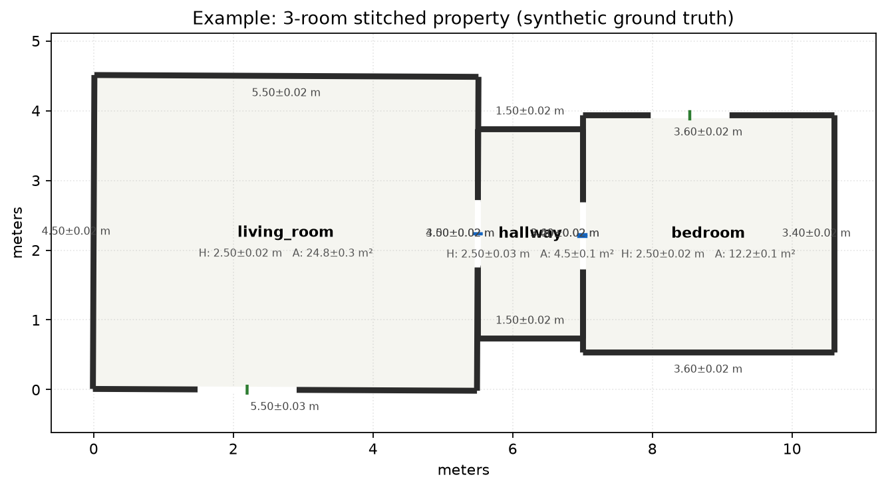
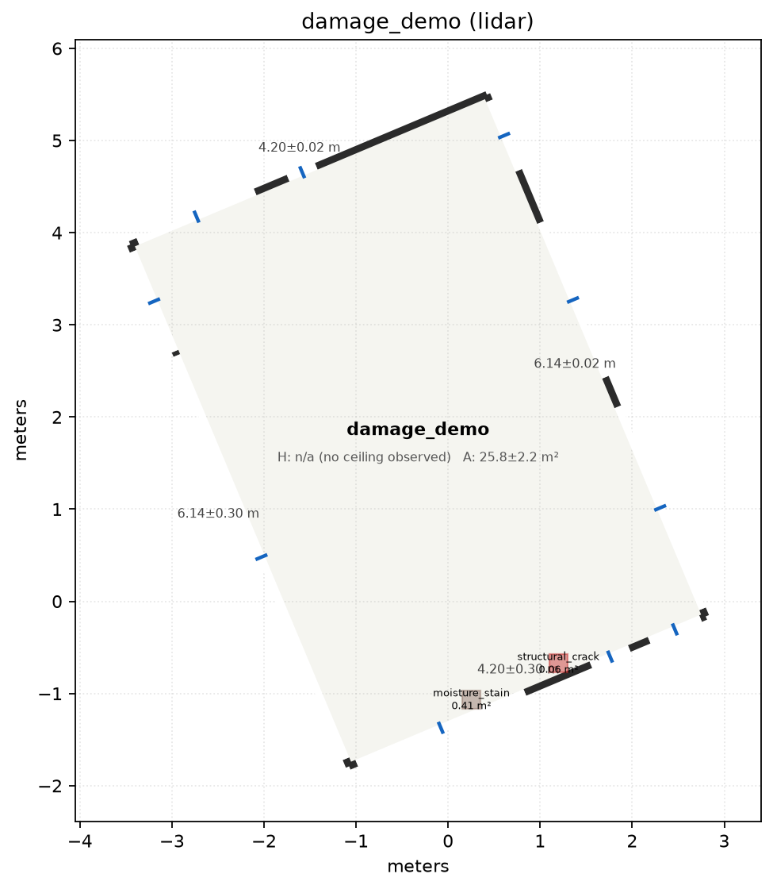

# 10 - UI/UX: the Rendered Plan

[cozmoscan/render/plan_renderer.py](../cozmoscan/render/plan_renderer.py)'s
`render_property_plan()` is the "rendered plan" deliverable: a dimensioned top-down PNG meant to
be recognisable to a homeowner, matching the spec's framing ("one whole-property floor plan a
homeowner would recognise from poly.cam or magicplan") - not a debug scatter plot.

## What it draws

- **Walls**: thick dark segments between each wall's global-frame endpoints.
- **Openings**: a literal gap in the wall line at the opening's position, with a small colored
 tick mark at its center - blue for doors, green for windows (door/window classification comes
 from `Opening.kind`, itself from the sill-height rule in `manhattan_room.py`).
- **Dimensions**: every wall's length is labeled directly on the plan as `value±ci m` - the
 confidence interval is visible on the plan itself, not hidden in the JSON only.
- **Per-room summary**: room name, ceiling height (or `"n/a (no ceiling observed)"`, never a
 guessed number), and floor area, all with their own CI, centered in the room's floor polygon.
- **Damage overlays** (optional `damage_regions` param): colored patches keyed by
 `damage_class` (`moisture_stain`/`structural_crack`/`mold`), labeled with class + area.
- Takes a **list** of `RoomModel` (one room, or a whole stitched property) uniformly - the same
 renderer draws both `plan.png` and `property_plan.png`.

See example renders: [docs/assets/property_plan_example.png](assets/property_plan_example.png)
(3-room stitched property, synthetic ground truth) and
[docs/assets/single_room_damage_example.png](assets/single_room_damage_example.png) (single
room with 2 damage markers).

## Design choice: damage markers are NOT to-scale footprints

A `DamageRegion`'s `polygon_xy` lives in its **surface's own local (along-surface, height)**
frame - it describes a shape on a *vertical* wall. A top-down floor plan is a *horizontal*
slice through the room at some height. These two are not the same plane, so a damage region's
polygon cannot be literally/geometrically projected onto the floor plan - there is no
information in "a stain 1.2m along the wall, between 0.4m and 0.9m up" that maps to a
to-scale horizontal footprint at all.

`cozmoscan/pipeline.py::_damage_region_to_plan_marker()` instead renders each damage region as a
small **fixed-size (0.2m x 0.2m) position marker**: it takes the region's along-wall center
(`polygon_xy[:, 0].mean()`), places it at that offset along the correct wall, and nudges it
0.15m outward (along the wall's normal) so the marker sits just outside the wall line rather
than overlapping it, purely for legibility. This is a deliberate, disclosed design choice -
the marker communicates **where** damage is, not **how large it looks from above** (which is a
meaningless question for wall damage). The marker's label text (`damage_class` + `area_m2`)
carries the actual measured extent, which *is* meaningful and is exactly what's reported in the
JSON/scope line items.

## Known rendering limitations

- With many openings close together (e.g. on real-data captures still affected by the opening
 over-detection residual, see [11_known_limitations.md](11_known_limitations.md)), dimension
 labels can visually overlap - a legibility issue, not a correctness issue (the underlying
 JSON data is unaffected).
- No scale bar / north arrow / legend is drawn - a homeowner-facing product polish item, not
 attempted here given the engineering-time-vs-report-length tradeoff the spec explicitly asks
 to be weighed.
