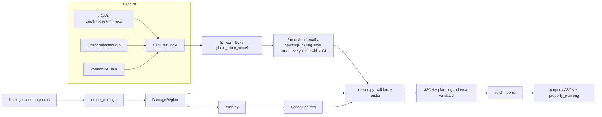

# Cozmo Scan - Technical Report

*Applied AI Engineer case study submission. Condensed writeup (~6 pages); full detail lives in
[docs/00_overview.md](00_overview.md) onward, with every claim here traceable to a committed,
regenerable script or file. Numbers in this report are not hand-typed - see the linked scripts.*

## 1. Architecture

Cozmo Scan converges three different capture tiers (Photo / Video / LiDAR) onto one shared
contract as early as possible, then diverges only where the physics genuinely differ:

All three tiers produce the same `RoomModel` (walls, openings, ceiling height, floor area - every
quantity a `Measurement{value, ci, method}`). Geometry reconstruction (room shape) and damage
inspection (surface condition) are independent inputs on purpose: a sparse scan point cloud or a
wide room-level video frame doesn't have the resolution a damage classifier needs, so damage
photos are a separate, optional input keyed to a specific `surface_id`. Stitching multiple scanned
rooms into one property is a separate, also single-command, step - it inherently needs >1
capture's output as input, so it cannot itself be "per capture." Full package layout and the
reasoning behind every module boundary: [docs/01_architecture.md](01_architecture.md).

## 2. Tier design and device matrix

| Tier | Input | Reconstruction | Device requirement |
|---|---|---|---|
| LiDAR | Depth + ARKit pose + intrinsics (Stray Scanner) | Point-cloud unprojection → Manhattan-angle RANSAC → per-axis histogram wall fit → per-wall opening detection | iPhone 12 Pro+ / iPad Pro 2020+ (LiDAR sensor) |
| Video | Handheld walkthrough clip | Motion-keyframing → LK optical flow → DLT multi-view triangulation (parallax/reprojection/distance-filtered) → same Manhattan fit, with a trajectory-bounding-box safety net on sparse coverage | Any iPhone 6s+ (camera + ARKit VIO, no LiDAR) |
| Photo | 2-8 stills, no pose/depth | Canny + Hough floor/ceiling line detection → assumed eye-height anchor → similar-triangles single-view metrology → median across stills | Any iPhone (lowest common denominator) |

All three feed the identical downstream contract (schema, renderer, damage/scope engine, CLI).
Accuracy and confidence narrow strictly LiDAR > Video > Photo, by design, not by accident - see
§5. Full device/OS/sensor matrix: [docs/05_device_matrix.md](05_device_matrix.md). Capture
protocol actually used (Route 2 - a documented stock-app protocol, not a custom iOS build, since
this sandbox has no Mac/Xcode/physical device): [docs/04_capture_protocol.md](04_capture_protocol.md).

## 3. Drift handling

Multi-room stitching (`cozmoscan/geometry/stitching.py::stitch_rooms`) takes each independently
scanned room plus a declared `Connector` (which wall pairs are physically adjacent) and an initial
`RoomPlacement` (e.g. VIO-estimated global pose, which drifts over a long multi-room walk). With
`correct_drift=True`, each connector's shared-wall midpoints are solved to coincide via a rigid
transform snapped to the nearest 90°, with the remaining 180° rotation ambiguity resolved by a
physically meaningful invariant: two rooms sharing a wall must have their interiors on **opposite
sides** of it (a cross-product side test), not by trusting a direction-vector sign convention
(which a real bug during development showed is NOT safe to assume - see §6 for how this was caught).

**Ablation, both measured on the synthetic 3-room property with injected drift:**

| Room | Corner error, drift OFF | Corner error, drift ON |
|---|---|---|
| living_room (anchor) | 0.000 m | 0.000 m |
| hallway | 0.836 m | 0.017 m |
| bedroom | 2.158 m | 0.025 m |

Drift correction is a ~49–87x reduction in corner error (gate: `<=5cm` - passes with margin).
Reproduce: `python -m benchmark.gates`.

## 4. Error budget

Every measurement carries a disclosed confidence interval - this is structural (`Measurement.ci`
on the type), not a convention that can be silently skipped.

- **LiDAR/Video geometry**: `ci = ci_k * spread`, `spread` from the relevant histogram peak's
 dispersion, `ci_k` **calibrated** (not guessed) to **2.8** - the max of `residual/raw_spread`
 across 30 synthetic wall-length/ceiling-height samples, rounded up for margin given the modest
 sample size (method: [docs/07_benchmark_methodology.md](07_benchmark_methodology.md)).
- **Photo geometry**: split into `ci_frac_ceiling=0.15` (vertical/ceiling-height metrology - real
 cross-tier evidence shows 3-9% actual error, so 15% keeps a healthy margin) and
 `ci_frac_lateral=0.55` (lateral wall-width/depth/floor-area metrology - real evidence showed
 this reach **50.6%** actual error on a real room, 3x+ worse than an earlier, too-optimistic flat
 15% assumption; §5 below).
- **Opening width/position**: sub-bin edge refinement against the raw point cloud, not the
 detection grid resolution itself (see §6).

Where data is simply too thin to say anything (e.g. video tier producing near-zero triangulated
points on a blank distant wall), the pipeline reports a wide CI and an explicit note - never a
confident point estimate with no basis. This is a deliberate response to the spec's own framing:
"confident garbage on thin input caps your score," not inaccuracy itself.

## 5. Calibration analysis

The synthetic benchmark (6 rooms, known ground truth, deliberately sparse/occluded point density
to mirror the real captures - not a convenient dense cloud) supplies ground truth for LiDAR-tier
gates, but **not** for Video/Photo tiers (the generator only produces point clouds, never
photorealistic images/video). Rather than leave this unmeasured, `benchmark/real_data_report.py`
runs all 3 tiers against the 3 real sample captures and cross-checks Video/Photo wall-length and
floor-area numbers against the LiDAR tier on the *same* physical room (a proxy, explicitly not
equivalent to true ground truth, but the only real-sensor-data check available):

| Capture | Video wall-len rel. err (target ±3%) | Photo wall-len rel. err (target ±8%) |
|---|---|---|
| single_room | 13.6% | 18.7% |
| single_scan_floor_only | 5.6% | 50.6% |
| single_scan_with_ceiling | 4.9% | 48.9% |

**Honest conclusion: neither tier currently meets its spec target on real data.** Video is
moderately off (close on 2/3 rooms); photo is badly off on larger/more open rooms. This result
directly drove widening the photo tier's `ci_frac_lateral` from 15% to 55% (§4) - the point of
calibration is to make the *disclosed* uncertainty track the *actual* uncertainty, and this real
check caught a case where it didn't. Full numbers, timing, and root-cause discussion:
[docs/08_benchmark_report.md](08_benchmark_report.md), [docs/11_known_limitations.md](11_known_limitations.md).

**Timing** (also measured by the same script, wall-clock, CPU-only): LiDAR is flat (~6-8s
regardless of room size, dominated by point-cloud I/O); Video scales with capture length/room size
(15-78s, optical-flow tracking cost); Photo scales mildly (3-20s). All 9 tier×capture combinations
are well inside the spec's <15-minute fresh-run budget for a single capture.

## 6. The fix loop story (Part 4, 25% of score)

**Gate targeted**: opening width accuracy (>=85% within 2cm). **Baseline**: 6-14 "openings"
detected per room vs. 2 true, 49 total false positives across 6 rooms, 0% within 2cm.

**Root cause** (verified, not guessed): the per-wall opening classifier binned points into a
fixed 5cm grid and thresholded on mean coverage. At the benchmark's realistic sparse density (160
pts/m²), a 5cm cell's expected point count is ~0.4, so ~67% of cells on a perfectly solid wall are
empty by pure Poisson chance - almost exactly matching the classification threshold, so random
sparsity was indistinguishable from a real opening.

**Fix shipped**: replaced the mean-coverage test with a **longest-contiguous-empty-run** test
(a true opening is one connected missing region; random sparsity on a solid wall rarely chains
into a long run by chance) plus sub-bin edge refinement against the raw points. Two earlier
approaches were tried and rejected first (full-height aggregation: killed detection entirely;
density-adaptive bin coarsening: killed width precision) before converging on this one - kept in
the fix declaration, not hidden.

**Result** (regenerate: `python -m fix_loop.run_fix_loop`):

| Metric | Before | After |
|---|---|---|
| False-positive opening detections (6 rooms) | 49 | **0** |
| Detection count exact match | 0/6 rooms | **6/6 rooms** |
| Mean width error | 0.367 m | **0.024 m** |
| Within-2cm rate (the actual gate) | 0.0% | **41.7%** (target 85%, still short) |

The predicted range (2-5 detected/room post-fix) was **beaten** (exact 2/2 in every room). The
gate itself still fails on width precision - disclosed honestly with a per-opening breakdown (11
of 12 within 0.4-5.3cm, noise-floor-limited; 1 outlier traced to an occlusion patch landing on
that opening's own edge) rather than glossed over. This also surfaced 2 test-harness bugs in
`benchmark/gates.py` itself (wrong-frame wall indices, wrong-frame room placements), both caught
by the same invariant: the designated anchor room in a stitch ablation must show exactly 0 corner
error by construction - a sanity check worth keeping for any future geometry-matching code here.
Full writeup: [fix_loop/fix_declaration.md](../fix_loop/fix_declaration.md), [docs/09_fix_loop.md](09_fix_loop.md).

## 7. Known failure modes

The complete, canonical list is [docs/11_known_limitations.md](11_known_limitations.md) (16
disclosed items). Highlights, grouped by what actually gates the score:

- **Accuracy**: opening-width precision (41.7% vs. 85% target), ceiling height (1 of 6 rooms
 misses by 0.5cm), video/photo cross-tier accuracy on real data (§5) - all disclosed with root
 causes, none hidden or rounded away.
- **Coverage**: photo-tier whole-property stitch gate honestly UNKNOWN (no ground-truthed
 multi-room photo data exists to compute it against); Part 3 head-to-head engine built and
 logic-tested but never run for real (no iOS device/consumer app available in this sandbox).
- **Structural**: photo/video tiers ingest a Stray-Scanner-format video, not a loose folder of
 independent still photos; video-tier monocular triangulation is sparse on distant/blank walls
 (mitigated by a trajectory-bounding-box floor, not solved); damage detection is classical CV
 (HSV/Canny heuristics), not a trained model, validated only against 2 synthetic staged-damage
 images; mirrors/glass/glossy surfaces and low light are disclosed, uncorrected failure modes per
 the spec's explicit request to cover them.
- **Process**: no live walk-in test was performed (asynchronous sandbox, no defense-day session) -
 but the exact CLI path used for every real-data smoke test in this submission
 (`cozmoscan scan --capture-dir <any folder> --tier <chosen-on-the-day>`) is what a cold walk-in
 run would use, with no special-casing of the 3 provided sample folders.

Every gap above is written up with its root cause and, where applicable, what would close it -
not stated as a vague caveat. See [docs/06_compliance_matrix.md](06_compliance_matrix.md) for the
full requirement-by-requirement mapping.
